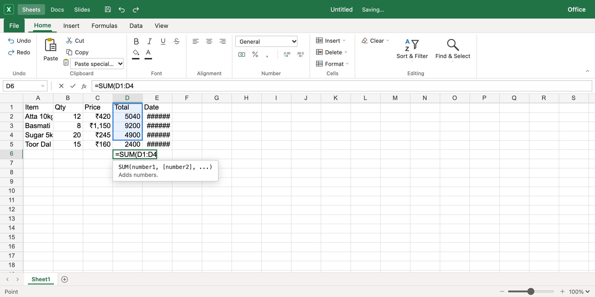

# Work Office

An open-source office suite — **Sheets**, **Docs** and **Slides** — with a fast
Rust engine that runs in the browser (WebAssembly) and on the desktop.

**Status:** early development. Sheets is usable; Docs and Slides are next.
See the [roadmap](docs/ROADMAP.md).



## Home

Opening the app shows a start page like Microsoft 365's: create a blank workbook, open or drop an `.xlsx`/`.csv` file, or reopen a recent file. Every workbook is saved in your browser automatically.

## Sheets today

- Canvas grid with virtual scrolling up to Excel's limits (1,048,576 × 16,384), resizable columns
- Formulas with automatic, incremental recalculation and cycle detection
- [158 functions](crates/sheets-engine/FUNCTIONS.md): `SUM`, `IF`, `XLOOKUP`, `VLOOKUP`, `SUMIFS`, `TEXT`, `PMT`, `NPV`, `SUBTOTAL`, dates, statistics…
- Dynamic arrays like Excel 365: `FILTER`, `SORT`, `UNIQUE`, `SEQUENCE`, `XMATCH`, `LET`… spill into neighbouring cells
- Formulas across sheets (`Sheet2!A1`, `'My Data'!B:B`), whole columns/rows, F4 for `$` references
- Formula autocomplete with syntax hints; click or drag cells (or use arrow keys) to insert references, shown in colour
- Fill handle: drag to continue series (1, 2, 3 → 4, 5; Item 1 → Item 2; Mon → Tue; Jan → Feb) and copy formulas with shifted references
- Formatting: bold, italic, underline, strikethrough, text and fill colours, alignment, number formats (₹ with Indian grouping, $, %, dates, times)
- Typing `18%`, `₹1,500` or `15-08-2025` sets the matching format automatically
- Insert/delete rows and columns (formulas are rewritten), sort, find & replace, Go To, zoom, right-click menu, AutoSum
- Notes on cells (Shift+F2) and hyperlinks (Ctrl+K) to web pages, e-mail or places in the workbook
- Sheet tabs: drag to reorder (Ctrl+drag copies), Move or Copy, tab colours, hide and unhide, Ctrl+PgUp/PgDn
- Paste Special: values only, formatting only, formulas only, transpose
- Cell layout: borders, fonts, wrap text, merge & center, row heights, hide/unhide, freeze panes
- Data tools: filter dropdowns, custom sort, remove duplicates, data validation (dropdown lists, limits, alerts), conditional formatting (highlight rules, data bars, colour scales)
- Charts (column, bar, line, area, pie, doughnut, scatter) that update live with the data, pictures, shapes and text boxes; move, resize, titles, legend, data labels, colours
- Open and save **.xlsx** (values, formulas, formatting, layout, data tools, charts, pictures, page setup) and **.csv** (also .tsv/.txt, delimiter detected); Ctrl+S saves to a file on disk
- Print with preview and export PDF (Ctrl+P): page setup, print area, titles on every page, headers/footers, fit to page
- Multiple sheets (add, rename, delete), undo/redo for everything, autosave in the browser
- Copy/paste with Excel and Google Sheets; inside Office, paste keeps formulas and formatting
- Typing in any language, including IME input (Hindi, Chinese, Japanese…)

### Keyboard

| Keys | Action |
|---|---|
| Arrows, PageUp/PageDown, Home | Move |
| Ctrl/⌘ + arrows (Shift to select) | Jump to the edge of the data |
| Ctrl/⌘ + Home / End | First cell / last used cell |
| Ctrl + G or F5, or type in the Name Box | Go to a cell or range |
| Shift + Space / Ctrl + Space | Select row / column |
| Alt + = | AutoSum |
| Ctrl + K | Insert link |
| Shift + F2 | New / edit note |
| Ctrl + PgUp / PgDn | Previous / next sheet |
| Shift + arrows | Extend selection |
| Type anything | Replace cell content |
| F2 or double-click | Edit cell content |
| Enter / Tab (Shift to reverse) | Confirm and move |
| Alt + Enter | New line inside the cell |
| Ctrl/⌘ + Enter | Put the entry in every selected cell |
| F4 (while typing a formula) | Cycle `$A$1` → `A$1` → `$A1` → `A1` |
| Escape | Cancel edit (or close the suggestion list) |
| Arrows while typing a formula after `(`, `,` or an operator | Insert a reference (Shift extends it) |
| ↑ ↓ then Tab/Enter in the suggestion list | Pick a function |
| Delete | Clear selection |
| Ctrl/⌘ + Z, Ctrl/⌘ + Shift + Z, Ctrl + Y | Undo, redo |
| Ctrl/⌘ + C / X / V | Copy, cut, paste |
| Ctrl/⌘ + Shift + V | Paste values only (more in Home → Paste special and the right-click menu) |
| Ctrl/⌘ + B / I / U | Bold, italic, underline |
| Ctrl/⌘ + D / R | Fill down / right within the selection |
| Ctrl/⌘ + F / Ctrl + H | Find / Find and replace |
| Ctrl/⌘ + mouse wheel | Zoom |
| Ctrl/⌘ + S, F12 | Save to disk, Save As |
| Ctrl/⌘ + P | Print / PDF |
| Ctrl/⌘ + Shift + L | Filter on/off |
| Alt + ↓ | Open the cell's dropdown list or the column's filter |
| Delete (chart or picture selected) | Delete it; arrows nudge it, Esc goes back to the cells |
| Drag the fill handle (hold Ctrl/⌥ to count up from a single number) | Fill a series |
| Double-click the fill handle | Fill down to the end of the neighbouring column |
| Drag / double-click a column border | Resize / autofit a column |

## Install

Work Office installs as separate apps — **Work Sheets**, **Work Docs** and **Work Slides**
(Docs and Slides are in development and turn into the full apps through updates).
Download them from the [latest release](https://github.com/bgscode/work-office/releases/latest):

| Computer | File |
|---|---|
| macOS (Apple silicon and Intel) | `Work.Office_<version>_universal.dmg`: open it and drag the three apps to Applications |
| Windows 10/11 | `Work.Sheets_<version>_x64-setup.exe` (and the same for Docs and Slides), or the `.msi` files |
| Linux | `.AppImage` (any distribution: make it executable and run), `.deb` (Ubuntu/Debian) or `.rpm` (Fedora) |

**Updates are automatic:** when an app starts it checks for a new version, downloads it in the
background and asks to restart. (Linux `.deb`/`.rpm` installs update with the new package.)

The installers aren't signed by Apple or Microsoft yet, so the first launch needs one extra step:

- **macOS:** right-click the app → **Open**. If macOS says the app is damaged, run
  `xattr -cr "/Applications/Work Sheets.app"` in Terminal once (same for Docs and Slides).
- **Windows:** in the SmartScreen prompt choose **More info → Run anyway**.

**Make Work Sheets the default app for spreadsheets:** on macOS, select any `.xlsx` file in Finder →
**Get Info** (⌘I) → **Open with: Work Sheets** → **Change All…** (do the same for `.csv`).
On Windows, right-click an `.xlsx` → **Open with → Choose another app → Work Sheets** →
**Always**. Double-clicking a file then opens it in Work Sheets, and Ctrl+S / ⌘S saves back to it.

## Quick start (developers)

You need [Rust](https://rustup.rs), [wasm-pack](https://rustwasm.github.io/wasm-pack/installer/),
Node.js 20+ and [pnpm](https://pnpm.io) 10.

```sh
rustup target add wasm32-unknown-unknown
pnpm install
pnpm dev          # builds the engine, then serves http://localhost:5173
```

Other commands:

```sh
pnpm test         # Rust + TypeScript tests
pnpm lint         # rustfmt + clippy
pnpm typecheck
pnpm build        # production build in apps/web/dist
pnpm --filter @office/desktop tauri build   # desktop app for this computer (apps/desktop)
```

The desktop app also needs the [Tauri prerequisites](https://v2.tauri.app/start/prerequisites/)
for your system. Pushing a tag like `v0.3.0` builds the installers for every system on GitHub
Actions and publishes them as a release; see [docs/RELEASING.md](docs/RELEASING.md).

## How it fits together

```
apps/web            React UI: grid on <canvas>, formula bar, ribbon
apps/desktop        Tauri desktop apps (Work Sheets, Docs, Slides) around apps/web
packages/engine     TypeScript wrapper around the WebAssembly build
crates/wasm         wasm-bindgen bindings (thin layer)
crates/sheets-engine  cells, formulas, dependency graph, recalculation
crates/formats      .xlsx / .csv import and export
crates/core         shared ids, undo/redo
```

Read [docs/ARCHITECTURE.md](docs/ARCHITECTURE.md) for the full picture and
[crates/sheets-engine/README.md](crates/sheets-engine/README.md) for a tour of
the spreadsheet engine.

## Contributing

Contributions are welcome — new spreadsheet functions are a great first issue.
Start with [CONTRIBUTING.md](CONTRIBUTING.md). Everyone taking part follows the
[Code of Conduct](CODE_OF_CONDUCT.md).

## License

Licensed under either of [Apache License 2.0](LICENSE-APACHE) or
[MIT license](LICENSE-MIT) at your option. Unless you state otherwise, any
contribution you submit is dual-licensed the same way, without additional terms.
